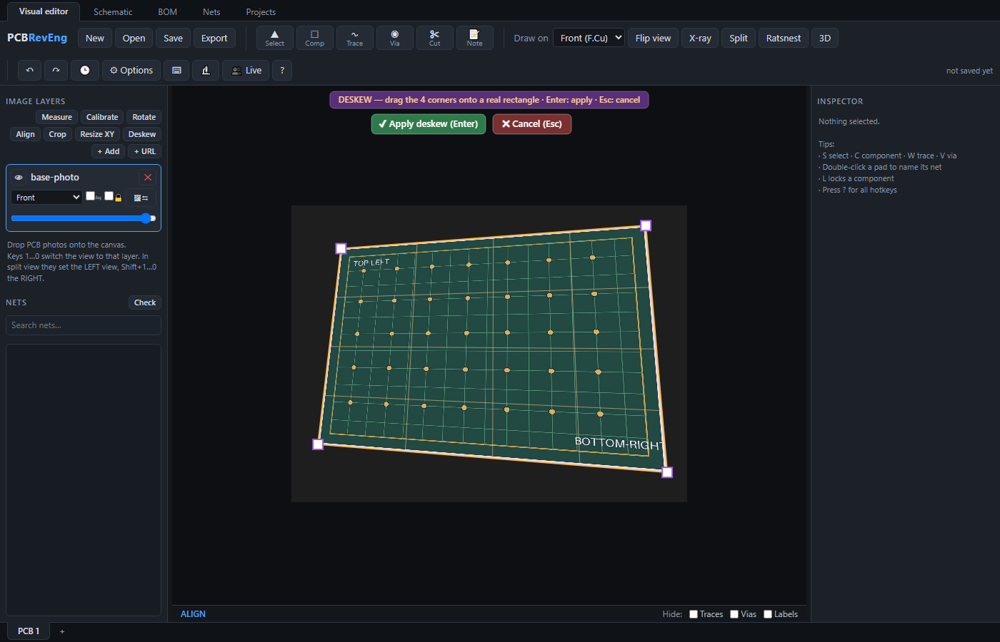
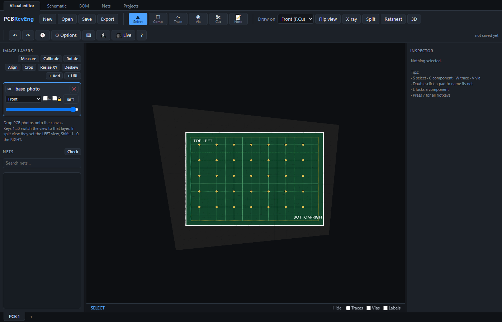

# Loading and Aligning Photos

Each photo of the board is an image layer. You stack the front, back and any inner layer photos and line them up so the same pad sits in the same place on every layer.

## Adding photos

There are three ways to add a photo.

- Drag one or more image files from your computer onto the canvas.
- Click **+ Add** at the top of the left panel, then choose the image files.
- Click **+ URL** to load an image straight from a web address (see below).

Each photo becomes a card in the Image layers list on the left. The program guesses the side from the file name; a name containing back or bottom is set to Back, one containing inner is set to an inner layer, and one containing xray is set to X-ray.

## Loading a photo from a web address

Click **+ URL** and paste the address of an image to load it live from the web instead of from a file. This is handy for quickly pulling in a photo that is already hosted online.

Please read the warning shown in the box: a hosted image is **not** saved inside your project — only the link to it is. The picture is fetched again every time you open the project, so if the link ever changes or goes offline the layer will disappear. Hosted layers are marked with a 🔗 in the layer list. For anything you want to keep, download the image and add it as a file with **+ Add** instead.

## Very large photos

Huge, high-resolution scans (many thousands of pixels across) are handled automatically. When you add a large image file, the program builds it into tiles at several zoom levels and only draws the parts you are looking at, at a detail level that matches your zoom. This keeps even gigapixel-sized photos smooth to pan and zoom, with no setup on your part.

## The layer card

Each layer card has these controls.

- The eye button shows or hides the layer.
- The name is shown in the middle.
- The cross button removes the layer. You are asked to confirm.
- The side dropdown sets which physical side this photo shows: Front, Back, an inner layer, or X-ray.
- The Mirror tick flips the image left to right. Back photos usually need this so they line up with the front.
- The Lock tick stops the layer from being dragged by accident.
- The Align button starts the four point alignment described below.
- The slider at the bottom sets the layer opacity.

Click the body of a card to make that layer the active one. The active layer is the one that align, deskew and dragging act on.

## Setting up front and back

1. Add the front photo. Leave it on Front.
2. Add the back photo. Set its side dropdown to Back. The Mirror tick turns on by itself so the back lines up with the front.
3. Lower the opacity of the top layer with its slider so you can see both photos at once while you line them up.

## Straightening a crooked photo with Deskew

If a photo was taken at an angle, use Deskew to remove the perspective and rotation. Do this to the base photo before you align anything else.

1. Select the photo's layer in the list. For your first photo that is the base layer.
2. Click **Deskew** in the Image layers panel on the left.
3. A four-cornered shape appears over the photo. Drag each corner onto the corner of something that is really a rectangle, such as a chip or the whole board. Drag inside the shape to move all four corners together.

4. Click **Apply deskew** (or press Enter) to straighten the photo. Esc or **Cancel** leaves it untouched.

The shape is stretched into a true rectangle, so perspective and rotation are removed in both directions at once. The photo's outer edges stay slanted, because the whole picture is warped along with the board.

A few things to know:

- The width-to-height ratio of the rectangle is estimated from the shape you draw, so pick something whose corners you can place accurately. If the proportions still look off, use the Resize XY tool afterwards to enter a known width and height.
- All four corners must sit on the photo, and the shape must stay four-sided without crossing over itself. Otherwise Deskew tells you what to fix and keeps the shape open.
- Applying Deskew without moving any corner does nothing.
- Deskew rewrites the photo's pixels, so deskew a photo before you align other photos to it. Deskewing a layer that is already aligned throws that alignment away, and the program asks you to confirm first. You can undo a Deskew with Ctrl+Z.

## Lining up a photo with Align

Use Align to make a second photo sit exactly on top of the base. This corrects position, rotation, scale and skew in one step.

1. Select the photo you want to move and click its **Align** button.
2. Click four features on this photo that you can also recognise on the base photo. Spread them out toward the corners for the best result. Good choices are corner pads or mounting holes.
3. The program then asks for the destinations. Switch the view to the base photo, then click the same four features in the same order on the base.

After the fourth destination click the photo snaps into place and a message reports how close the match was. The view returns to the layer you aligned.

## Quick adjustments by hand

With the Align tool active you can also nudge a layer directly.

- Drag the layer to move it.
- Hold Shift and drag to rotate it.
- Hold Alt and turn the mouse wheel to scale it.

Lock a layer once it is positioned so you do not move it by mistake.

## Switching which photo you see

Press the number keys 1 through 9 and 0 to jump the view to image layers 1 through 10. In the Options dialog you can change the number keys to toggle visibility instead of switching the view. In split view the numbers set the left half and Shift with a number sets the right half — see [[Viewing the Board|Viewing-the-Board]].
